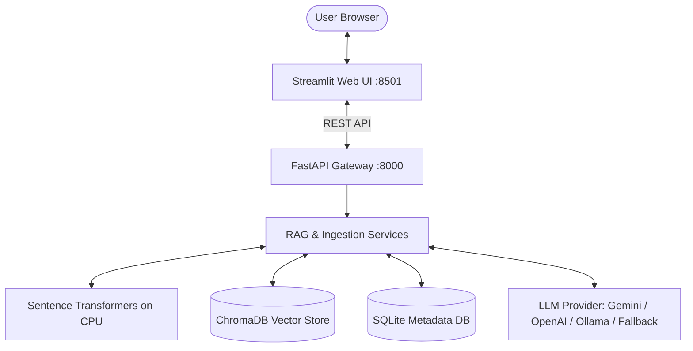
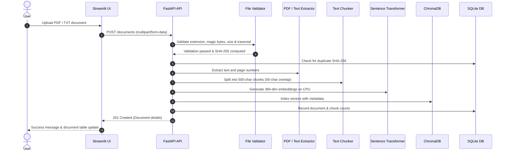
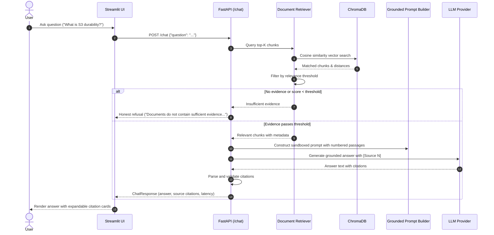

# CloudDocs AI — Production-Grade Grounded RAG Platform

> **Verifiable, Secure, and Hallucination-Resistant Document Intelligence**

[](https://www.python.org/)
[](https://fastapi.tiangolo.com/)
[](https://streamlit.io/)
[](https://www.trychroma.com/)
[](LICENSE)
[](tests/)
[](evaluation/)

---

## 1. Project Title & Tagline
**CloudDocs AI** is an open-source, production-ready Retrieval-Augmented Generation (RAG) platform designed to eliminate hallucinations, enforce prompt injection safety, and provide verifiable document question-answering with exact page-level citations.

---

## 2. Overview: The Problem & The Solution

### The Problem
Modern Large Language Models (LLMs) suffer from three critical production vulnerabilities:
1. **Hallucination**: LLMs confidently invent incorrect facts when they do not know the answer.
2. **Lack of Verifiable Sources**: Answers rarely cite verifiable original documents or page numbers.
3. **Prompt Injection Attacks**: Malicious text inside uploaded documents can override system instructions and extract sensitive prompts or perform unauthorized actions.

### The Solution: CloudDocs AI
CloudDocs AI implements a grounded RAG architecture that:
- Ingests PDF and TXT documents, validating file headers, magic bytes, and sanitizing paths against directory traversal attacks.
- Chunks text deterministically and generates dense 384-dimensional vector embeddings locally using `all-MiniLM-L6-v2` on CPU.
- Performs cosine similarity retrieval against a persistent ChromaDB vector store and SQLite metadata database.
- Gated Relevance Check: If retrieved evidence is missing or falls below a configurable relevance threshold, the system **honestly refuses** to answer rather than guessing.
- Isolates untrusted document passages in sandboxed XML delimiters, neutralizing prompt injection attempts.
- Enforces strict citations: Every factual statement is backed by `[Source N]` tags referencing real filenames and page numbers.

---

## 3. Architecture Overview

CloudDocs AI is structured in clean, decoupled layers:
- **Presentation Layer**: A modern Streamlit web application providing a system dashboard, document ingestion manager with drag-and-drop uploads, interactive grounded chat with source citation cards, and system diagnostics.
- **API Gateway Layer**: A high-performance FastAPI server exposing RESTful endpoints for document lifecycle (`/documents`), grounded chat (`/chat`), and component health monitoring (`/health`).
- **Core Engine**: Domain services orchestrating file validation, PyMuPDF extraction, natural boundary text chunking, local sentence embeddings, ChromaDB vector indexing, and grounded prompt synthesis.
- **Storage Layer**: SQLite for relational document tracking and metadata alongside persistent ChromaDB for high-dimensional vector search.

---

## 4. Architecture Diagrams

### High-Level Architecture


### Document Ingestion Flow


### Retrieval & Grounded Q&A Flow


---

## 5. Key Features

- **Grounded, Verifiable Responses**: Answers strictly rely on indexed document evidence.
- **Honest Refusal Mechanism**: If documents do not have the answer or match scores are low, the system explicitly states: *"The provided documents do not contain sufficient evidence to answer this question."*
- **Page-Level Citations**: Interactive citation cards show the document name, exact page number, relevance score percentage, and text snippet.
- **Strict Prompt Injection Defense**: Source documents are treated as untrusted data using delimiter sandboxing and instruction isolation.
- **Local CPU Embeddings**: Uses `sentence-transformers/all-MiniLM-L6-v2` locally on CPU. No external embedding API calls or GPU hardware required.
- **Multi-Provider LLM Engine**: Seamlessly switch between Google Gemini (`gemini-2.5-flash`), OpenAI (`gpt-4o-mini`), local Ollama (`llama3.2`), or the built-in deterministic `NoLLMProvider` fallback.
- **Enterprise File Validation**: Enforces magic bytes verification, MIME type matching, max file size enforcement, and path sanitization.
- **Zero Hallucination Guardrails**: High-confidence filtering stops ungrounded queries before reaching the LLM, saving inference costs and eliminating false statements.
- **Automated Evaluation Benchmark**: Built-in test harness verifying precision, refusal accuracy, and anti-injection resilience.

---

## 6. Tech Stack & Justifications

| Component | Technology | Version | Justification |
|---|---|---|---|
| **Programming Language** | Python | 3.14.4 | Latest standard Python runtime with enhanced performance and type annotations. |
| **Backend Framework** | FastAPI | 0.135+ | Asynchronous REST framework with automatic OpenAPI documentation and strict Pydantic v2 schemas. |
| **ASGI Web Server** | Uvicorn | 0.44+ | Lightning-fast asynchronous server implementation for FastAPI. |
| **Frontend UI** | Streamlit | 1.66+ | Rapid, interactive data dashboard framework enabling rich visual cards, tabs, and chat widgets. |
| **Vector Database** | ChromaDB | 1.5+ | Lightweight, embedded vector store with native HNSW indexing, persistent on disk without external server overhead. |
| **Embedding Model** | Sentence Transformers | 6.2+ | `all-MiniLM-L6-v2` produces dense 384-dim semantic embeddings with fast inference on standard commodity CPUs. |
| **Relational Database** | SQLite | 3.x (built-in) | Serverless, zero-maintenance relational database for document metadata, checksums, and chunk counters. |
| **PDF Extraction** | PyMuPDF (`pymupdf`) | 2.0+ | Extremely fast, reliable C-based PDF text and metadata extraction with page tracking. |
| **Evaluation & Testing**| Pytest & Custom Benchmark | 9.1+ | Robust automated regression testing framework with 41 passing unit, integration, and evaluation tests. |

---

## 7. Prerequisites

Before installing CloudDocs AI, ensure your system has:
- **Operating System**: Linux (Ubuntu 22.04+ / Debian), macOS (Apple Silicon or Intel), or Windows (WSL2 recommended).
- **Python**: Python 3.11, 3.12, 3.13, or 3.14 installed.
- **Memory**: Minimum 2 GB RAM (4 GB recommended for embedding processing).
- **Disk Space**: ~1.5 GB free space for virtual environment, models, and dependencies.
- **Git**: Installed for version control.
- *(Optional)* **Docker & Docker Compose**: If running via containers.

---

## 8. Quick Start Guide for Beginners

Follow these simple steps in your terminal to get CloudDocs AI running:

### Step 1: Clone or Navigate to the Repository
```bash
cd clouddocs-ai
```

### Step 2: Create and Activate a Python Virtual Environment
```bash
# Create virtual environment named .venv
python3 -m venv .venv

# Activate on Linux / macOS:
source .venv/bin/activate

# (On Windows PowerShell):
# .venv\Scripts\Activate.ps1
```

### Step 3: Install Dependencies
```bash
# Install CPU-optimized PyTorch first (fast & lightweight)
pip install torch --index-url https://download.pytorch.org/whl/cpu

# Install application dependencies
pip install -r requirements.txt
```

### Step 4: Configure Environment Variables
Copy the template configuration file:
```bash
cp .env.example .env
```
Open `.env` in any text editor. By default, CloudDocs AI runs in **Fallback mode** (`LLM_PROVIDER=none`), allowing you to test document upload, indexing, retrieval, and search without any API keys!

If you want generative answers, add your Google Gemini or OpenAI API key:
```env
LLM_PROVIDER=gemini
GEMINI_API_KEY=your_gemini_api_key_here
```

---

## 9. Configuration (`.env.example` Explained)

Every configuration setting in `.env` is loaded safely through Pydantic settings:

| Variable | Default Value | Description |
|---|---|---|
| `HOST` | `127.0.0.1` | Network interface to bind the FastAPI backend server. |
| `PORT` | `8000` | Port for the FastAPI backend server. |
| `DEBUG` | `false` | Enable or disable debug mode and verbose logging. |
| `UPLOAD_DIRECTORY` | `./data/uploads` | Path to store original uploaded raw PDF and TXT documents. |
| `CHROMA_PERSIST_DIRECTORY` | `./data/vector_db` | Path where ChromaDB vector index is persistently saved. |
| `SQLITE_DB_PATH` | `./data/metadata.db` | Path to SQLite database storing document metadata and checksums. |
| `MAX_UPLOAD_SIZE_MB` | `10` | Maximum allowable upload file size in megabytes. |
| `ALLOWED_EXTENSIONS` | `.pdf,.txt` | Comma-separated list of permitted file extensions. |
| `CHUNK_SIZE` | `500` | Target character count per text chunk. |
| `CHUNK_OVERLAP` | `50` | Character overlap count between consecutive text chunks. |
| `EMBEDDING_MODEL` | `all-MiniLM-L6-v2` | SentenceTransformer model used for embedding generation. |
| `LLM_PROVIDER` | `none` | LLM service provider: `gemini`, `openai`, `ollama`, or `none`. |
| `LLM_MODEL` | `gemini-2.5-flash` | Specific model name for the selected provider. |
| `RELEVANCE_THRESHOLD` | `0.3` | Minimum cosine similarity score required to accept evidence. |
| `MAX_RETRIEVED_CHUNKS`| `5` | Maximum number of top context passages passed to the LLM. |
| `FASTAPI_URL` | `http://localhost:8000` | Backend API URL used by the Streamlit frontend. |

---

## 10. Running the Application

CloudDocs AI consists of two separate processes: the **FastAPI Backend** and the **Streamlit Frontend**. Run each in a separate terminal with your virtual environment activated:

### Terminal 1: Launch FastAPI Backend
```bash
source .venv/bin/activate
uvicorn app.main:app --host 127.0.0.1 --port 8000 --reload
```
- API Docs (Swagger UI): **http://localhost:8000/docs**
- Health Check: **http://localhost:8000/health**

### Terminal 2: Launch Streamlit Frontend
```bash
source .venv/bin/activate
streamlit run frontend/streamlit_app.py --server.port 8501
```
- Open in your browser: **http://localhost:8501**

---

## 11. Running with Docker & Docker Compose

When running in an environment with Docker and Docker Compose installed:

```bash
# Build images and start all services in the background
docker-compose up --build -d

# Check running container status
docker-compose ps

# View backend and frontend logs
docker-compose logs -f

# Shut down services and maintain persistent data
docker-compose down
```
- Streamlit UI will be accessible at: **http://localhost:8501**
- FastAPI Backend will be accessible at: **http://localhost:8000**

---

## 12. Running Tests

The test suite contains 41 automated tests covering file validation, chunking, ingestion, vector store operations, retrieval thresholds, prompt injection defense, and API endpoints.

```bash
# Activate your virtual environment
source .venv/bin/activate

# Run full pytest suite with verbose output
python -m pytest tests/ -v

# Run with test coverage report
python -m pytest tests/ --cov=app --cov-report=term-missing
```

---

## 13. Running the Automated Evaluation Harness

CloudDocs AI features an automated benchmark script in `evaluation/evaluate.py` testing retrieval precision, honest refusal accuracy, and prompt injection resilience across 6 real-world test cases:

```bash
# Run standalone evaluation harness
.venv/bin/python evaluation/evaluate.py
```

### Interpreting Benchmark Results:
```
================================================================================
CloudDocs AI — Automated RAG Evaluation Results
================================================================================
Timestamp:               2026-10-23 23:38:46 UTC
Total Evaluation Cases:  6
Passed:                  6 (100.0%)
Failed:                  0 (0.0%)

Retrieval Precision:     100.0%
Negative Refusal Acc:    100.0%
Anti-Injection Defense:  100.0%
Average Latency:         0.0104s
================================================================================
```
The detailed output is saved to [`evaluation/results.json`](file:///home/pragati-meri-jaan/sih%20winners/clouddocs-ai/evaluation/results.json).

---

## 14. API Documentation

| Method | Endpoint | Description | Request Body / Params | Expected Response |
|---|---|---|---|---|
| `GET` | `/health` | System health, component status, and safe configuration | None | `200 OK` (JSON) |
| `POST` | `/documents` | Upload and index a PDF or TXT file | `file: UploadFile` (form-data) | `201 Created` (JSON) |
| `GET` | `/documents` | List all indexed documents and statistics | None | `200 OK` (JSON list) |
| `GET` | `/documents/{id}` | Retrieve metadata for a specific document | Path parameter `{id}` | `200 OK` (JSON) |
| `DELETE` | `/documents/{id}` | Delete document, raw file, and vector chunks | Path parameter `{id}` | `200 OK` (JSON) |
| `POST` | `/chat` | Ask a grounded question using indexed documents | `{"question": "...", "threshold": 0.3}` | `200 OK` (ChatResponse) |

### Example Chat Request:
```bash
curl -X POST http://localhost:8000/chat \
  -H "Content-Type: application/json" \
  -d '{"question": "What is Amazon S3 durability?"}'
```

### Example Chat Response:
```json
{
  "question": "What is Amazon S3 durability?",
  "answer": "Amazon S3 provides 99.999999999% (11 9's) data durability across multiple Availability Zones [Source 1].",
  "citations": [
    {
      "citation_index": 1,
      "document_id": "doc_9c7f21a4",
      "filename": "aws_storage_whitepaper.pdf",
      "page_number": 4,
      "relevance_score": 0.8841,
      "snippet": "Amazon S3 Standard is designed for 99.999999999% durability of objects over a given year..."
    }
  ],
  "llm_provider": "gemini",
  "latency_seconds": 0.642,
  "insufficient_evidence": false
}
```

---

## 15. Project Directory Structure

```
clouddocs-ai/
├── app/
│   ├── api/                     # FastAPI route controllers
│   │   ├── chat.py              # POST /chat grounded question-answering
│   │   ├── documents.py         # POST, GET, DELETE /documents
│   │   └── health.py            # GET /health system telemetry
│   ├── database/
│   │   └── metadata.py          # SQLite schema & document metadata queries
│   ├── generation/
│   │   ├── llm.py               # Configurable LLM adapters (Gemini, OpenAI, Ollama, NoLLM)
│   │   └── prompt.py            # Anti-injection, grounded prompt engineering
│   ├── ingestion/
│   │   ├── chunker.py           # Text sliding-window chunking engine
│   │   ├── file_validation.py   # Magic bytes, extension, traversal security checks
│   │   ├── pdf_loader.py        # PyMuPDF text & page extractor with scanned detection
│   │   └── text_loader.py       # UTF-8 text parser
│   ├── retrieval/
│   │   ├── embeddings.py        # Local SentenceTransformer embedding generator
│   │   ├── retriever.py         # Vector similarity search & relevance gating
│   │   └── vector_store.py      # ChromaDB persistent collection interface
│   ├── schemas/
│   │   ├── chat.py              # Pydantic models for chat requests, citations, responses
│   │   └── documents.py         # Pydantic models for document metadata
│   ├── services/
│   │   ├── document_service.py  # Ingestion coordinator service
│   │   └── rag_service.py       # Grounded RAG execution service
│   ├── config.py                # Environment configuration using Pydantic Settings
│   └── main.py                  # FastAPI application entrypoint & lifecycle
├── data/                        # Persistent local storage (gitignored)
│   ├── metadata.db              # SQLite relational database
│   ├── uploads/                 # Raw uploaded document storage
│   └── vector_db/               # Persistent ChromaDB vector collection
├── docs/
│   └── architecture.md          # In-depth architectural specification & Mermaid flowcharts
├── evaluation/
│   ├── dataset.json             # 6 standardized benchmark evaluation scenarios
│   ├── evaluate.py              # Quantitative evaluation harness script
│   └── results.json             # Benchmark telemetry and performance results
├── frontend/
│   ├── api_client.py            # Client adapter for FastAPI endpoints
│   └── streamlit_app.py         # Interactive multi-tab Streamlit web application
├── tests/                       # Complete automated pytest suite (41 tests)
├── .env.example                 # Configuration template
├── .gitignore                   # Safe Git exclusions
├── Dockerfile                   # Production-grade non-root container image
├── docker-compose.yml           # Multi-service container orchestration
├── pyproject.toml               # Project metadata and tool configuration
├── requirements.txt             # Locked Python dependencies
└── README.md                    # Comprehensive documentation
```

---

## 16. The RAG Pipeline Explained (For Beginners)

If you are new to AI and Computer Science, **RAG** stands for **Retrieval-Augmented Generation**. Here is how CloudDocs AI executes the 5 core steps:

1. **Extract**: When you upload a document, we read the raw text. For PDFs, we read the document page by page so we always remember which page each sentence came from.
2. **Chunk**: LLMs have memory limits. We break large documents into smaller pieces called **chunks** (~500 characters each) with a small overlap (~50 characters) so concepts aren't sliced in half.
3. **Embed**: We convert each text chunk into a list of 384 numbers called an **embedding vector**. Words with similar meanings have vectors pointing in nearly the same mathematical direction.
4. **Retrieve**: When you ask a question, we convert your question into a vector and search our **Vector Store** (ChromaDB) to find the text chunks mathematically closest to your question.
5. **Generate**: We send the retrieved text chunks along with your question to the LLM and command it: *"Answer the user's question using ONLY these numbered passages. If the answer is not here, say you don't know."*

---

## 17. Security & Safety Mechanisms

- **File Validation**: Files are checked for true magic byte signatures (`%PDF-` for PDFs, valid UTF-8 for text). File size is capped at 10 MB.
- **Path Sanitization**: Filenames are strictly cleaned of path separators (`/`, `\`, `..`), preventing attackers from overwriting critical system files.
- **Prompt Injection Neutralization**: Document passages are enclosed in `<untrusted_evidence>` tags. The system prompt instructs the model to disregard instructions found inside documents.
- **Secret Isolation**: API keys are kept strictly in memory, never written to disk, and redacted from `/health` and UI interfaces.
- **Honest Refusal**: The system refuses to guess when relevance falls below the threshold, preventing damaging hallucinations in production.

---

## 18. Known Limitations

- **Scanned Image PDFs**: Does not currently include an OCR engine (such as Tesseract). PDFs consisting solely of scanned images will trigger a warning alerting the user that no text was extracted.
- **Tabular & Image Analysis**: Vector search operates on extracted plain text; diagrams, charts, and embedded images within PDFs are not parsed.
- **Single-Node Storage**: ChromaDB and SQLite run embedded on the local filesystem. Highly distributed clustering requires transitioning to pgvector or Milvus.
- **CPU Embedding Throughput**: Generating embeddings on CPU is cost-effective and portable, but bulk ingestion of thousands of pages concurrently will be slower than dedicated GPU clusters.

---

## 19. Troubleshooting Guide

| Issue | Cause | Solution |
|---|---|---|
| `ModuleNotFoundError: No module named 'app'` | Running script outside project root | Ensure you are in `clouddocs-ai` root directory and virtual environment is activated (`source .venv/bin/activate`). |
| `PyPDF / fitz DeprecationWarning` | Old PyMuPDF import syntax | CloudDocs AI imports `import pymupdf` directly to ensure modern compatibility. |
| `Frontend fails to connect to backend` | FastAPI server is not running | Start backend with `uvicorn app.main:app --port 8000` in a separate terminal. Verify `http://localhost:8000/health`. |
| `Gemini API quota or authentication error` | Invalid or expired API key | Check `GEMINI_API_KEY` in `.env`, or switch to `LLM_PROVIDER=none` to test local retrieval without API keys. |
| `Scanned PDF detected warning` | PDF contains only images | Upload a searchable PDF containing actual selectable text. |

---

## 20. Cloud Deployment Guide (AWS / GCP / DigitalOcean)

To deploy CloudDocs AI to a cloud Virtual Machine (e.g., AWS EC2 Ubuntu 24.04 instance):

### 1. Provision Instance & Firewall Rules
- Launch an **Ubuntu 24.04 LTS** instance (t3.medium or larger with 4GB RAM).
- In your cloud Security Group / Firewall, open:
  - Port `22` (SSH)
  - Port `80` (HTTP)
  - Port `443` (HTTPS)

### 2. Install Docker & Git on Server
```bash
sudo apt update && sudo apt install -y git docker.io docker-compose
sudo systemctl enable --now docker
sudo usermod -aG docker $USER
# Log out and log back in for docker group to take effect
```

### 3. Clone Repository & Setup Environment
```bash
git clone <your-repo-url> /opt/clouddocs-ai
cd /opt/clouddocs-ai
cp .env.example .env
nano .env  # Add your production API keys and configure settings
```

### 4. Deploy via Docker Compose
```bash
docker-compose up -d --build
```

### 5. Configure Nginx Reverse Proxy with HTTPS (Certbot)
Install Nginx and Certbot:
```bash
sudo apt install -y nginx certbot python3-certbot-nginx
```

Create `/etc/nginx/sites-available/clouddocs.conf`:
```nginx
server {
    server_name yourdomain.com;

    # Route UI to Streamlit
    location / {
        proxy_pass http://127.0.0.1:8501;
        proxy_http_version 1.1;
        proxy_set_header Upgrade $http_upgrade;
        proxy_set_header Connection "upgrade";
        proxy_set_header Host $host;
    }

    # Route API to FastAPI
    location /api/ {
        proxy_pass http://127.0.0.1:8000/;
        proxy_set_header Host $host;
        proxy_set_header X-Real-IP $remote_addr;
    }
}
```

Enable site and obtain SSL certificate:
```bash
sudo ln -s /etc/nginx/sites-available/clouddocs.conf /etc/nginx/sites-enabled/
sudo nginx -t && sudo systemctl reload nginx
sudo certbot --nginx -d yourdomain.com
```

---

## License
This project is licensed under the MIT License — see the LICENSE file for details.
